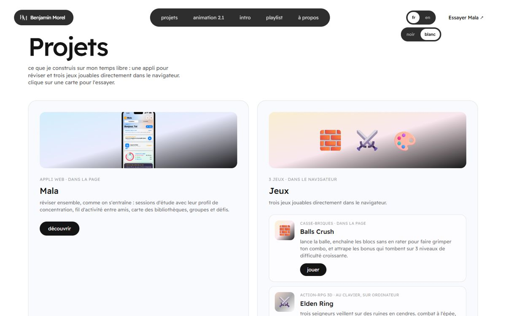

# Benjamin Morel — site personnel

Site personnel de Benjamin Morel, étudiant en licence de mathématiques à l'Université Paris Cité. On y trouve ses projets, son parcours, un film d'animation et une playlist. Le site est en français et en anglais, avec un thème clair et un thème sombre.

**→ [benjaminmorel1.github.io/sitepro](https://benjaminmorel1.github.io/sitepro/)**


## Ce qu'on y trouve

| Page | Adresse | Contenu |
|---|---|---|
| Accueil | [`/`](https://benjaminmorel1.github.io/sitepro/) | Vidéo de fond, titre animé, présentation en quelques chiffres |
| Projets | [`/platform`](https://benjaminmorel1.github.io/sitepro/platform) | **Mala**, l'appli pour réviser ensemble (carrousel de captures, lien vers l'appli), et quatre jeux jouables dans le navigateur |
| Animation 2.1 | [`/animation-2-1`](https://benjaminmorel1.github.io/sitepro/animation-2-1) | Biographie animée en 3D, générée par IA |
| Playlist | [`/music/`](https://benjaminmorel1.github.io/sitepro/music/) | Lecteur de musique avec pochettes et paroles synchronisées |
| À propos | [`/contact`](https://benjaminmorel1.github.io/sitepro/contact) | Présentation, formation, compétences, projets et contact |

Les jeux de la page Projets :
- **Balls Crush** : un casse-briques jouable directement dans la page, avec combos, bonus et 3 niveaux.
- **Elden Ring** : un action-RPG 3D (combat à l'épée, roulade, verrouillage de cible).
- **La prairie peinte** : une exploration 3D peinte touche par touche comme une toile à l'huile, avec un dragon à chevaucher.
- **Chessmata** : des échecs 3D en ligne contre des amis ou des IA, avec classement Elo. C'est ma version du projet open source [Chessmata](https://github.com/BenjaminMorel1/chessmata), hébergée sur Render.



## Fonctionnalités

- **Bilingue** français / anglais : chaque page garde ses textes dans un objet `STRINGS = { fr, en }`.
- **Thème clair / sombre**, qui suit le réglage de l'appareil et peut être changé à la main.
- **Lecteur de musique** qui continue d'une page à l'autre. Sur téléphone, il fonctionne aussi écran verrouillé.
- **Adapté au téléphone** et **installable** comme une appli (PWA).
- **Adresses propres** (`/contact`), avec un titre et une adresse de référence par page pour le référencement.
- **Animations** au défilement, qui respectent le réglage « réduire les animations » du système.
- **Statistiques de visite** avec GoatCounter (sans cookies) et Google Analytics 4.

## Technologies

| | |
|---|---|
| Interface | [React 19](https://react.dev) + [TypeScript](https://www.typescriptlang.org) |
| Outil de build | [Vite 8](https://vite.dev) |
| Styles | [Tailwind CSS 3](https://tailwindcss.com) |
| Navigation | [React Router 7](https://reactrouter.com) |
| Animations | [Motion](https://motion.dev), [Lenis](https://lenis.darkroom.engineering) (défilement fluide), [Flickity](https://flickity.metafizzy.co) (carrousel) |
| Hébergement | GitHub Pages, déployé par GitHub Actions |

## Lancer le projet

Il faut [Node.js](https://nodejs.org) 22 ou plus récent.

```bash
npm install
npm run dev        # serveur local sur http://localhost:5173
npm run build      # version de production dans dist/
npm run preview    # aperçu de la version de production
npm run lint       # vérification du code
```

## Organisation du code

```
src/
  main.tsx, App.tsx      point d'entrée et liste des pages
  pages/                 une page par adresse (Home, Platform, Contact, Film, …)
  components/            barre de navigation, carrousel Mala, lecteur de musique, Balls Crush, …
  i18n/                  choix de la langue
  analytics.ts           statistiques de visite
  theme.ts               thème clair / sombre
public/
  games/                 jeux autonomes (Elden Ring, La prairie peinte)
  music/, media/         musiques, pochettes et vidéos
scripts/pages.mjs        crée une page HTML par adresse après le build (voir plus bas)
.github/workflows/       déploiement sur GitHub Pages
```

## Déploiement

Chaque push sur `main` lance [le workflow](.github/workflows/deploy.yml), qui compile le site et le publie sur GitHub Pages.

GitHub Pages ne sait pas renvoyer toutes les adresses vers une appli React. Après `vite build`, le script `scripts/pages.mjs` écrit donc une copie de la page pour chaque adresse (`contact.html`, `platform.html`, …), avec son propre titre et sa propre adresse de référence, ainsi qu'un `404.html` de secours. Les anciens liens en `#/page` sont convertis automatiquement.

## Crédits

- **La prairie peinte** est construite sur le moteur *Oil paint* de [Patch](https://patch.gg) (code MIT, graphismes CC0) ; ses licences sont livrées avec le jeu dans `public/games/prairie-peinte/`.
- **Chessmata** est un fork du projet open source de Metavert LLC (licence MIT), personnalisé et hébergé séparément.
- Les musiques de la playlist appartiennent à leurs auteurs et ne sont là qu'à titre personnel.

## Contact

Benjamin Morel · [LinkedIn](https://www.linkedin.com/in/benjamin-morel-bb839a3ab/) · [page À propos](https://benjaminmorel1.github.io/sitepro/contact)
